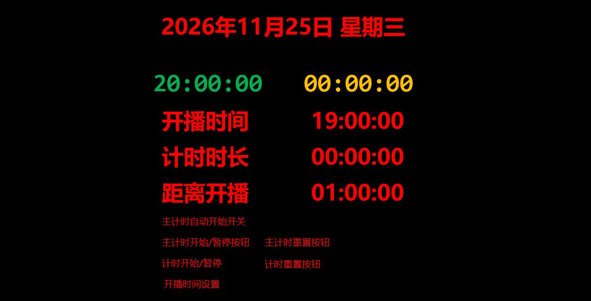

# 软件描述
这是一个给演播室用的计时软件，能够实现开播倒计时、开播计时、开播时间设置以及计时等功能

# 功能描述
- 日期显示：显示当前日期，星期
- 主时钟：绿色，显示当前时间
- 主计时：绿色，到开播时间开始计时，还未到开播时间时保持00:00:00
- 开播时间：红色，显示开播时间（24h制）
- 计时时长：红色，按下计时按钮之后的时长
- 距离开播：红色，显示距离开播时间的剩余时间，当开播时间
- 功能按钮
    - 主计时开始/暂停
    - 主计时重置
    - 主计时自动开始开关
    - 开播时间设置按钮，精确到分钟

# 界面设计
- 所有数字字体用适合时钟的等宽字体

- ui设计仅供参考